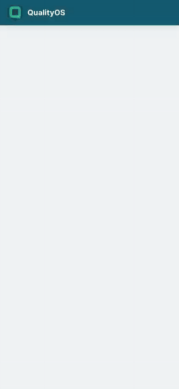
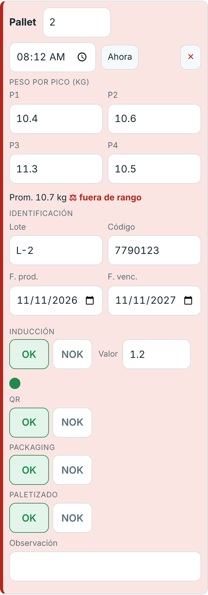
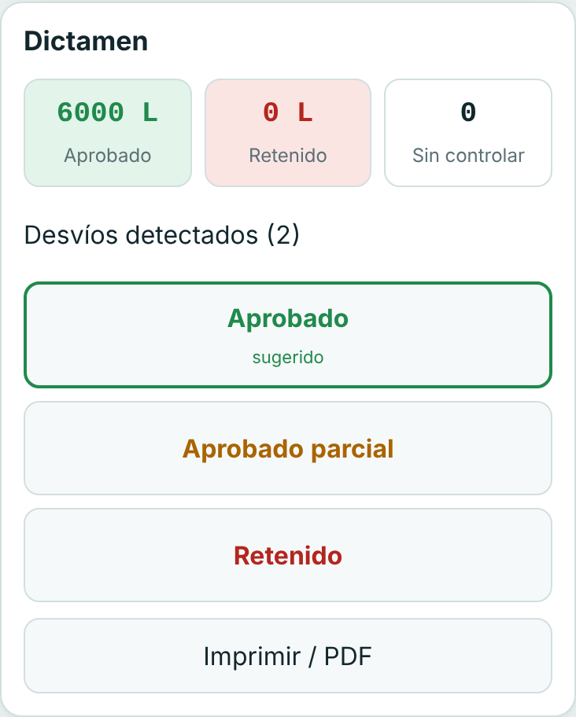
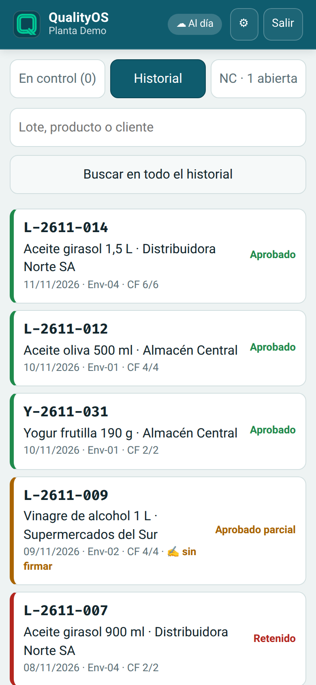

<div align="center">


# QualityOS · Control de lotes

**Del lote al dictamen, pallet por pallet, desde la tablet y aunque no haya señal.**

[Abrir la app](https://roca-byte.github.io/qualityos/) · [Video (1:30)](docs/video/qualityos-demo.mp4) · [Guía de uso](docs/GUIA.md) · [Cómo funciona](#cómo-se-usa) · [Diseño](docs/DISENO.md) · [Licencia](#licencia)



</div>

---

QualityOS es una app web instalable (PWA) para el **control de calidad de lotes en una planta
de envasado**. El inspector crea el lote, lo controla en la línea y en producto final, y lo
**dictamina**: Aprobado, Aprobado parcial o Retenido. Al final sale el registro del lote listo
para imprimir o guardar en PDF.

Es la primera app que desarrollé y el origen de la suite **QualityOS**. La versión original
usaba Firebase y funcionaba para una sola planta; esta es una **reconstrucción desde cero sobre
Supabase**, pensada para que varias empresas la usen con la misma instalación, cada una viendo
solo sus datos.

> **Probala sin cuenta:** abrí la app y tocá **“Probar sin cuenta (demo)”**. Entrás a una empresa de
> ejemplo con lotes cargados; lo que hagas queda solo en tu navegador y no toca ninguna base real.

## Qué resuelve

| En papel o Excel | Con QualityOS |
|---|---|
| Planillas que se completan a mano y se pasan en limpio | Se carga una vez, en la línea, desde la tablet |
| El peso fuera de rango o la inducción floja se ven tarde | Cada pico fuera de rango y la inducción fuera de tolerancia se marcan al instante (semáforo) |
| Cuentas de pallets y litros aprobados/retenidos a mano | La app las calcula y **sugiere el dictamen** |
| No queda claro quién dictaminó ni cuándo | Queda registrado: persona, rol, fecha y hora |
| Sin señal en planta, no se puede cargar | Funciona sin conexión y sube todo cuando vuelve la señal |
| Cada planta tiene su copia de la planilla | Varias empresas en una sola instalación, con datos separados |

## Cómo se usa

1. **Nuevo lote.** Producto, n° de lote, cliente, línea, fecha, inductora y rango de peso por
   pico.
2. **Control en línea**, pallet por pallet:
   - **Peso** en 4 picos, con promedio y aviso si alguno sale del rango.
   - **Identificación**: lote, código, fecha de producción y de vencimiento (se copian del
     pallet anterior para no tipear lo mismo).
   - **Inducción** OK/NOK con su valor y semáforo según la tolerancia de la inductora.
   - **QR, packaging y paletizado** OK/NOK.
   - Un NOK corregido en el momento se marca como **reprocesado**.
3. **Control final**, pallet por pallet: ID, trazabilidad/QR, estado del pallet e inducción,
   con un botón **"Todo OK"** para los pallets sin novedad. La app suma pallets y litros
   aprobados y retenidos.
4. **Dictamen.** La app sugiere uno según el control final; la persona decide. Si faltan
   pallets por controlar, solo **Coordinación** puede dictaminar igual, y queda asentado.
5. **Registro.** "Imprimir / PDF" arma el registro del lote en A4, con código y versión del
   documento. Los desvíos del lote se pueden copiar para pegarlos en el
   [registro de No Conformidades](https://github.com/roca-byte/calidad-no-conformidades).

Todo se ve en el **historial**, con búsqueda por lote, producto o cliente.

La primera vez, la app muestra una **bienvenida** con los pasos según el rol. La
[guía de uso](docs/GUIA.md) tiene el recorrido completo con capturas.

<p>



</p>

### Roles

| Rol | Qué puede hacer |
|---|---|
| **Inspector de Calidad** | Crear y controlar lotes. Dictaminar cuando el control final está completo |
| **Coordinación** | Lo anterior, más dictaminar con pallets pendientes, corregir o reabrir lotes dictaminados, borrar lotes y ver la auditoría |
| **Administración** | Todo lo anterior, más configurar la empresa (inductoras, líneas, datos del registro) e invitar personas |

Estos permisos los hace cumplir **la base de datos**, no solo la pantalla: esconder un botón
no alcanza para saltearlos.

### Acceso

QualityOS funciona **por invitación**. Cualquiera puede abrir el link y crear una cuenta, pero
para entrar a una empresa la tiene que invitar su administrador (con el mismo email). Las
empresas nuevas las da de alta el administrador de la plataforma.

## Por dentro

- **Sin señal primero.** La app trabaja siempre contra la copia de la tablet. Cada cambio queda
  en una "bandeja de salida" que se sube sola cuando hay conexión.
- **Nada se pisa.** Cada lote tiene un número de versión. Si dos equipos cambian el mismo lote,
  el servidor no acepta la versión vieja: la app avisa y deja elegir cuál queda.
- **Seguridad en la base.** Postgres con *Row Level Security*: cada fila pertenece a una
  empresa y la base impide ver o tocar datos de otra. Los lotes solo se guardan a través de una
  función que valida el rol.
- **Auditoría.** Cada versión de cada lote queda guardada con quién la hizo y cuándo.
- **Borrar no es borrar.** Un lote borrado queda marcado; así no "revive" si una tablet que
  estuvo sin señal sube una copia vieja.

Las decisiones y los problemas de la versión anterior que esto resuelve están en
[`docs/DISENO.md`](docs/DISENO.md).

### Tecnología

HTML, CSS y JavaScript puros, sin frameworks ni build. Base de datos y usuarios en
[Supabase](https://supabase.com) (Postgres). Única librería:
[supabase-js](https://github.com/supabase/supabase-js), incluida en el repo para que la app abra
sin internet. Comparte la identidad visual de la suite QualityOS: teal profundo, modo claro u
oscuro según el sistema y botones de 48 px para usar con guantes.

```
index.html               Estructura: barra superior + <main id="vista">
css/styles.css           Estilos (mobile first) + impresión A4
js/config.js             URL y clave pública de Supabase
js/reglas.js             Reglas de negocio puras: semáforo, peso, litros, dictamen
js/store.js              Datos en la tablet + bandeja de salida
js/nube.js               Todo lo que habla con Supabase
js/demo.js               Servidor de mentira del modo demo (y de las pruebas)
js/imprimir.js           Registro del lote para imprimir / PDF
js/app.js                Pantallas y eventos
sw.js                    Service worker: la app abre sin señal
supabase/migrations/     Tablas, seguridad (RLS) y funciones, en orden
tests/                   Pruebas de reglas, base de datos e interfaz
tools/demo.js            Genera las capturas y el GIF de la guía
tools/video.js           Graba el video de demostración (MP4)
docs/                    Guía de uso, guía de Supabase y decisiones de diseño
```

### Pruebas

```bash
node --test 'tests/*.test.js'   # reglas de negocio (solo Node, sin instalar nada)
tests/sql/correr.sh             # tablas y permisos contra un Postgres local
node tests/e2e/flujo.js         # recorrido completo de la interfaz (Playwright)
node tests/e2e/primer-uso.js    # cuenta nueva: registro, invitación y bienvenida
node tests/e2e/demo.js          # modo demo: funciona y no hace ningún pedido a Supabase
```

Las capturas de la guía y el GIF se regeneran con `node tools/demo.js`, y el video con
`node tools/video.js` (Playwright y ffmpeg, con datos de ejemplo ficticios). Conviene correrlos
cada vez que cambia algo visible.

### Instalar una copia propia

Para uso **no comercial** (ver la licencia):

1. Crear un proyecto en Supabase y cargar las migraciones: [`docs/SUPABASE.md`](docs/SUPABASE.md).
2. Poner la URL y la clave *publishable* del proyecto en `js/config.js`.
3. Publicar la carpeta en un hosting estático (GitHub Pages, Cloudflare Pages…). Las rutas
   son relativas, así que funciona en un subdirectorio.

Para probarla en la compu: `python3 -m http.server 8000` y abrir `http://localhost:8000`
(con `file://` el service worker no anda).

## Licencia

© 2026 Maximiliano Roca. [PolyForm Noncommercial 1.0.0](LICENSE).

El código está a la vista: lo podés leer, estudiar, probar y modificar para **uso no
comercial** (personal, educativo, de investigación o en organizaciones sin fines de lucro).
**Usarla en una empresa u ofrecerla como servicio requiere permiso del autor**: si te interesa,
[escribime](mailto:maxyroca7@gmail.com). Este resumen es orientativo; vale el texto de
[`LICENSE`](LICENSE).

Las versiones publicadas hasta el commit `4d632f5` inclusive siguen bajo licencia MIT para
quien las haya obtenido en ese momento. `vendor/supabase.js` mantiene su propia licencia MIT
(`vendor/supabase-LICENSE`).

---

<div align="center">

Parte de la suite **QualityOS** · [Más proyectos](https://github.com/roca-byte)

</div>
