# Guía de uso · QualityOS

Paso a paso para quien usa QualityOS por primera vez. Las capturas son de una empresa de
ejemplo ("Planta Demo") con datos inventados.

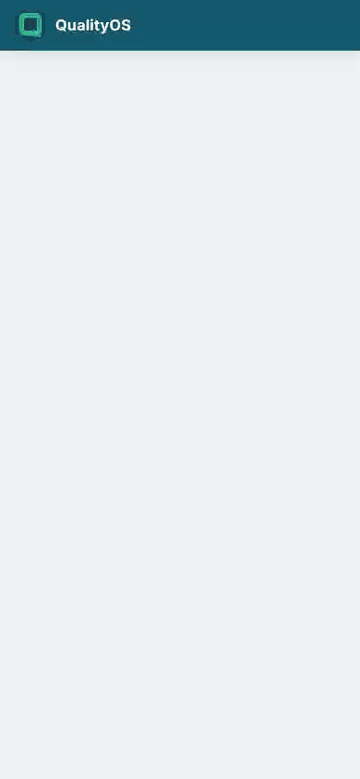

> **¿Querés verla antes de tener cuenta?** Abrí la app y tocá **“Probar sin cuenta (demo)”**: entrás a
> una empresa de ejemplo con lotes cargados. Todo lo que hagas queda solo en tu navegador y cada vez
> que entrás a la demo arranca de cero. También hay un [video de 2 minutos y medio](video/qualityos-demo.mp4).

**Contenido**

1. [Entrar por primera vez](#1-entrar-por-primera-vez)
2. [Crear un lote](#2-crear-un-lote)
3. [Control en línea](#3-control-en-línea)
4. [Control final](#4-control-final)
5. [Dictamen y registro](#5-dictamen-y-registro)
6. [No conformidades](#6-no-conformidades)
7. [Historial](#7-historial)
8. [Si administrás la empresa](#8-si-administrás-la-empresa)
9. [Sin señal](#9-sin-señal)
10. [Preguntas frecuentes](#10-preguntas-frecuentes)

---

## 1. Entrar por primera vez

QualityOS funciona **por invitación**: primero el administrador de tu empresa te invita con tu
email y tu rol. Después:

1. Abrí la app: <https://roca-byte.github.io/qualityos/>
2. Escribí **el mismo email de la invitación** y una clave (mínimo 6 caracteres) y tocá
   **Crear cuenta nueva**.
3. Te llega un mail para confirmar la cuenta. Tocá el link del mail.
4. Volvé a la app e **Ingresá** con tu email y tu clave.

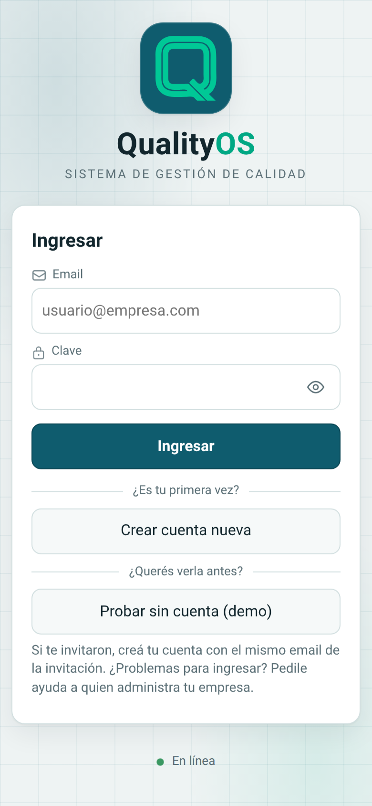

La primera vez aparece la **bienvenida**: escribí tu nombre (sale en la firma de cada dictamen)
y mirá los pasos según tu rol. Tocá **Empezar**. La bienvenida se puede volver a ver desde
**⚙ → Ver la guía de bienvenida**.

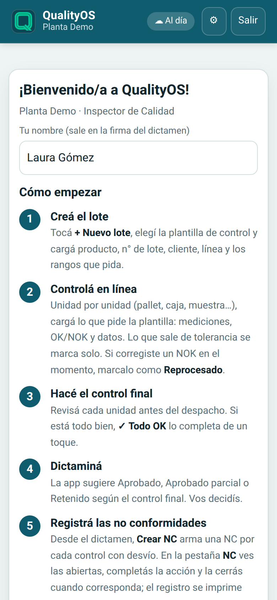

> 💡 **Instalala en el celular o la tablet:** en Chrome, menú ⋮ → *Agregar a la pantalla de
> inicio* (o *Instalar app*). Queda con su ícono y abre aunque no haya señal.

## 2. Crear un lote

En la pantalla principal ves los lotes **En control** y el **Historial**. Tocá **+ Nuevo lote**.

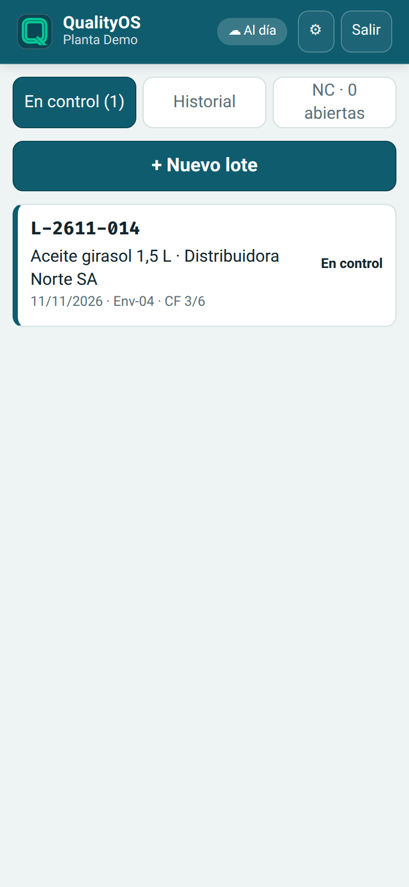 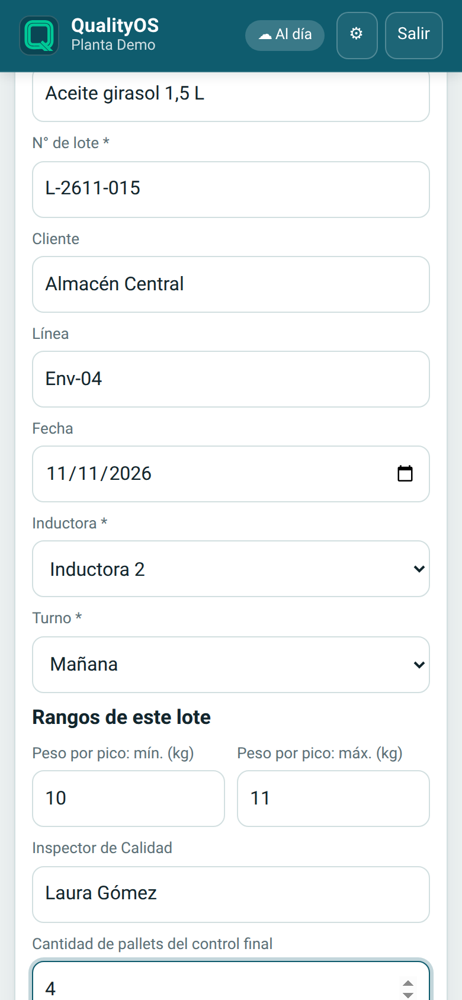

- **Producto**: si está en el **catálogo** de tu empresa, elegilo de la lista (o escribí su
  código y tocá Enter). La app completa sola la plantilla, los rangos, los datos del lote y la
  cantidad de unidades; podés cambiar lo que haga falta. Si no está, escribilo y completá el
  resto a mano.
- **Plantilla de control**: qué vas a controlar (si tu empresa tiene más de una, elegí la del
  producto o la línea).
- **Producto** y **N° de lote** son obligatorios.
- **Datos del lote** que pide la plantilla: por ejemplo la **inductora** y el **turno**. Los
  marcados con * son obligatorios.
- **Rangos de este lote**: las mediciones que dependen del producto (por ejemplo el peso por
  pico) piden acá su mínimo y máximo. Con eso la app marca lo que sale de rango.
- **Cantidad del control final**: cuántas unidades (pallets, cajas, muestras…) vas a revisar al
  final. Se pueden agregar o quitar después.

## 3. Control en línea

Unidad por unidad (pallet, caja, muestra…, según la plantilla), mientras la línea produce. Lo que
aparece depende de la plantilla; en el ejemplo de envasado de líquidos:

- **Hora**: el botón **Ahora** la completa.
- **Mediciones** (como el peso por pico, con 4 lecturas): la app calcula el promedio y avisa
  **fuera de rango** si alguna lectura sale de la tolerancia. Si la medición tiene **semáforo**,
  el círculo se pinta verde (dentro), amarillo (cerca) o rojo (lejos).
- **Datos y fechas** (lote del envase, código, producción, vencimiento): al agregar una unidad se
  copian de la anterior, así no tipeás lo mismo.
- **OK / NOK** (QR, packaging, paletizado…).

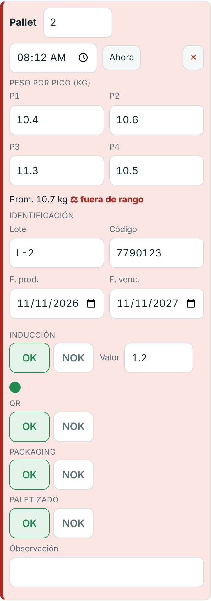 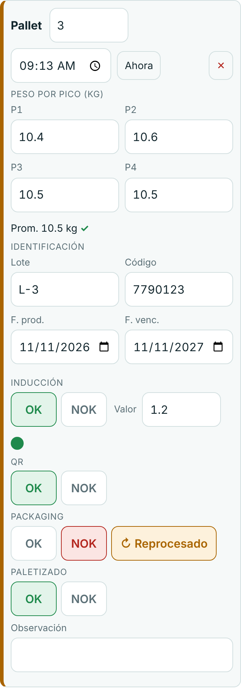

Si encontraste un NOK y **lo corregiste en el momento**, tocá **↻ Reprocesado**: queda
registrado como desvío corregido (la unidad se pinta en naranja en vez de rojo). Lo mismo
para una medición fuera de rango que se corrigió, si la plantilla lo permite.

En otra plantilla los controles son otros. Por ejemplo, en una de alimentos:

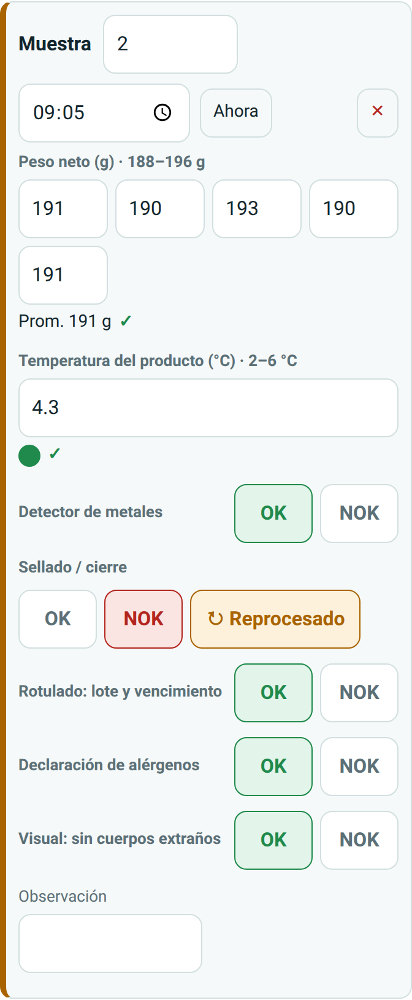

> Tocar otra vez un OK o NOK ya marcado lo deja sin marcar.

### Control por horario

Si la plantilla es **por horario** (por ejemplo, "cada 2 h"), cada control queda con su hora
(**Ahora** la pone) y arriba ves **Próximo control: 12:30**, contado desde el último control. Si
se pasa la hora, aparece **⏰ Control atrasado** en el lote y en su tarjeta de **En control**,
sin tener que tocar nada. Un control nuevo trae la hora actual; si la corregís, el próximo se
recalcula. Si el turno pasa la medianoche, la app lo entiende (una hora menor que la anterior es
del día siguiente).

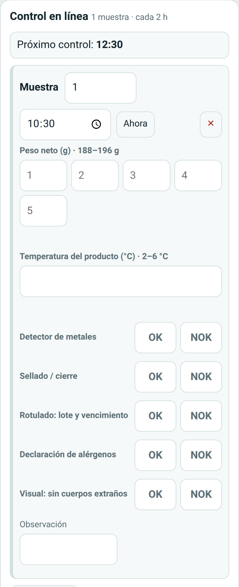

## 4. Control final

Antes del despacho, revisá cada unidad con lo que pida la plantilla. **✓ Todo OK** marca
todos los OK/NOK de un toque. Si la plantilla lleva cantidad, cargá la **cantidad por unidad**
una vez (por ejemplo 1000 L por pallet); si una tiene otra, ponela en *Cantidad (si difiere)*.

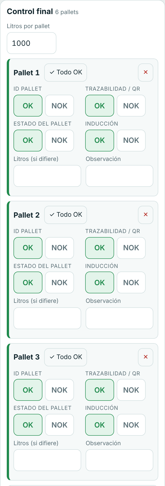

## 5. Dictamen y registro

Abajo de todo está el **Dictamen**: la app suma unidades y cantidades aprobadas y retenidas y
**sugiere** un resultado. Vos decidís:

- **Aprobado**: todo el lote está conforme.
- **Aprobado parcial**: una parte se aprueba y otra queda retenida.
- **Retenido**: el lote no se libera.

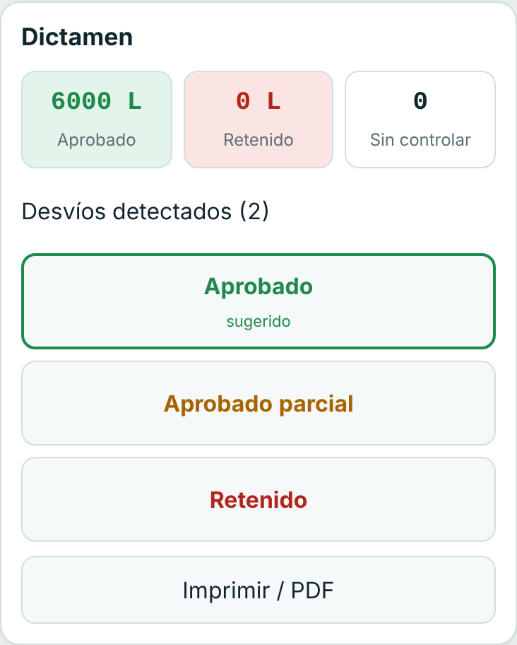 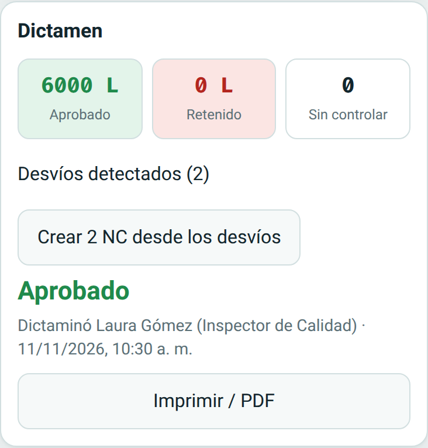

Si quedan unidades sin completar lo obligatorio, solo **Coordinación** puede dictaminar igual (y queda
asentado quién lo autorizó). Una vez dictaminado, el lote queda cerrado para el Inspector de
Calidad; Coordinación puede reabrirlo.

En **Desvíos detectados** ves la lista de NOK del lote. Desde ahí se crean las
**no conformidades** (ver el paso 6).

**Imprimir / PDF** arma el registro del lote en una hoja A4. En el diálogo de impresión elegí
*Guardar como PDF*.

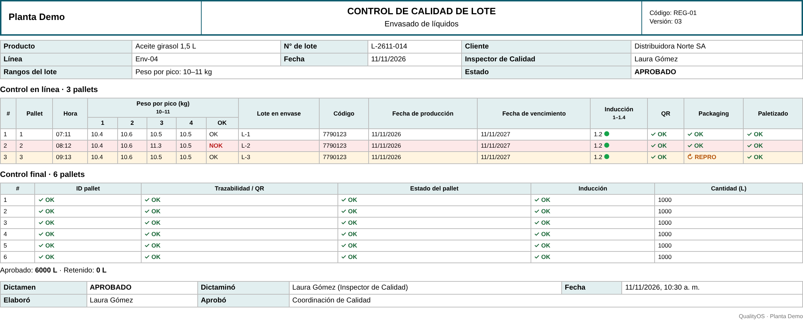

## 6. No conformidades

El registro de No Conformidades (NC) se carga **todos los días**, a medida que aparecen, y se
entrega **por mes**.

**Desde un lote.** En el dictamen, **Crear N NC desde los desvíos** arma una NC por cada control
con desvío: si el mismo control falló en varias unidades del lote, es **una** NC con todas esas
unidades. Ya traen la fecha, el lote, el producto, el cliente y dónde se detectó; lo que se
corrigió en el momento (reprocesado) entra **cerrado**. Después, en el lote ves sus NC.

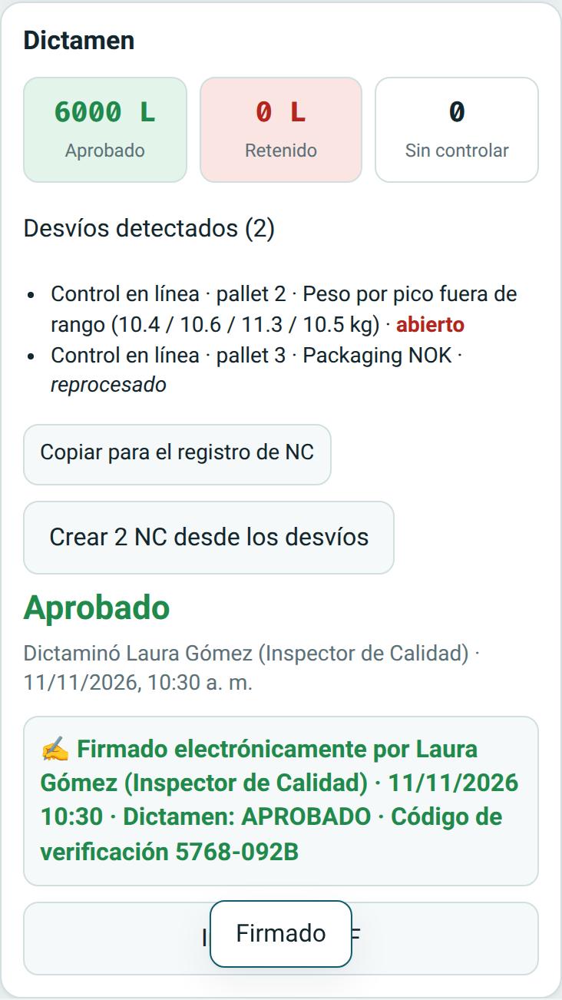

**La pestaña NC.** Arriba elegís qué ver: un **mes** (lo que se detectó ese mes) o **Abiertas,
todos los meses**, para el seguimiento diario. Los indicadores muestran cuántas hay, cuántas
siguen abiertas, cuántas tienen el **plazo vencido**, cuántas se cerraron en plazo y cuántas son
críticas. **+ Nueva NC** carga una a mano (un reclamo, un control de ingreso…) con la fecha de hoy.

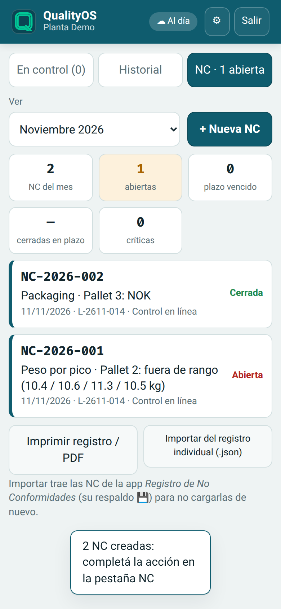 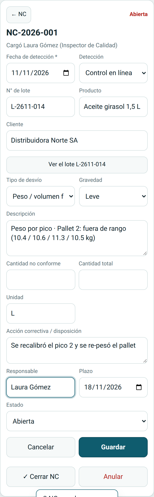

**La ficha de la NC.** El **tipo de desvío** completa la gravedad sugerida (se puede cambiar).
El **plazo** se calcula solo en días hábiles desde la detección; si lo cambiás a mano, se respeta.
Cargá la acción correctiva y el responsable, y pasala a **En proceso** si corresponde.

- **✓ Cerrar NC**: queda registrado quién la cerró y cuándo. Cualquiera de Calidad puede cerrarla.
- Después del cierre, la **verificación de eficacia** (ISO 9001, 10.2): Eficaz o No eficaz.
- **Anular**: para una NC cargada por error. Queda en el registro como anulada y no cuenta en
  los indicadores.

El **número** (NC-2026-001, NC-2026-002…) lo pone el servidor cuando la NC se sube: así dos
equipos sin señal no repiten número. Mientras tanto la NC dice *NC nueva*.

**Imprimir registro / PDF** arma el registro del mes elegido en A4 apaisado: la planilla de NC
con sus indicadores, las acciones con cierre y eficacia, y el espacio para las firmas.

**¿Usabas la app individual?** Si llevabas el registro en la app
[Registro de No Conformidades](https://github.com/roca-byte/calidad-no-conformidades), descargá
su respaldo (💾 Exportar backup) y acá tocá **Importar del registro individual**: trae las NC sin
repetirlas.

## 7. Historial

En **Historial** están los lotes dictaminados que tiene el equipo. **Buscar en todo el
historial** busca por lote, producto o cliente en el servidor (hace falta señal).

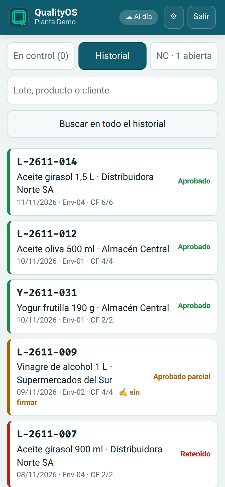

## 8. Si administrás la empresa

Tu bienvenida tiene otros pasos: configurar y armar el equipo.

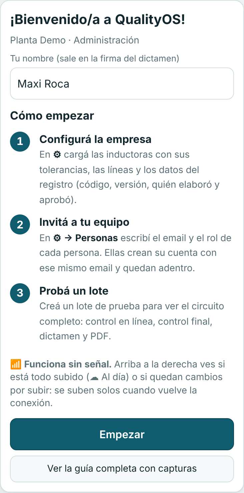

En **⚙**:

- **Empresa**: nombre y líneas.
- **Plantillas de control**: qué se controla en cada lote (ver abajo).
- **Productos**: el catálogo (ver abajo).
- **No conformidades**: el código y la versión del registro de NC, el plazo en días hábiles y la
  lista de **tipos de desvío** con su gravedad sugerida. Si un tipo se llama igual que un control
  de la plantilla (por ejemplo «Inducción débil»), las NC creadas desde un lote lo toman solas.
- **Personas**: invitá por email con su rol, cambiá roles o desactivá a alguien que ya no
  trabaja. La persona invitada crea su cuenta con ese email (paso 1) y queda adentro.

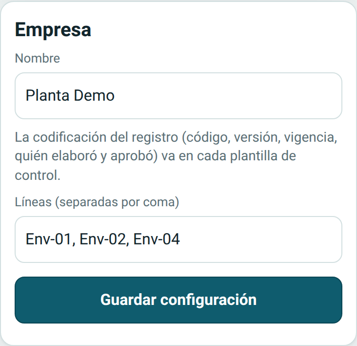 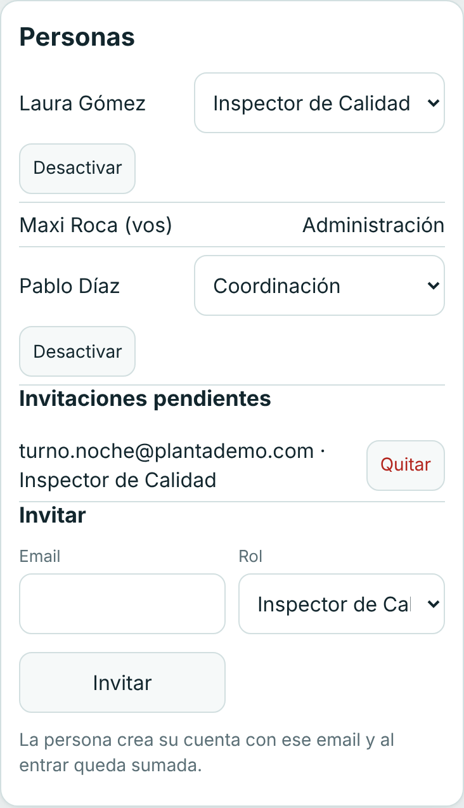

### Plantillas de control

Cada plantilla dice **qué se controla** en un tipo de lote. Podés tener varias (por producto o
por línea); al crear el lote se elige cuál usar. **+ Nueva plantilla** arranca desde un ejemplo
de tu rubro (agroquímicos, alimentos, bebidas, cosmética) o en blanco.

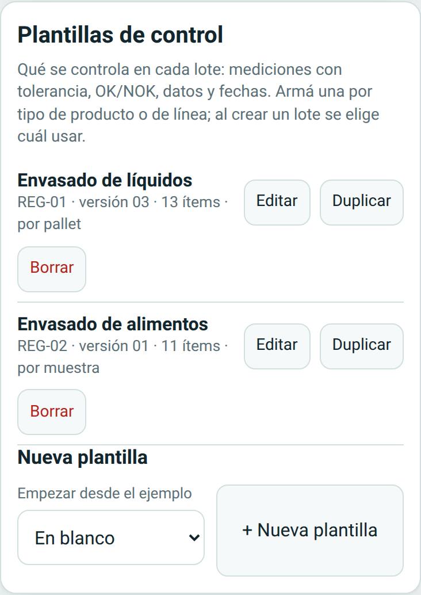 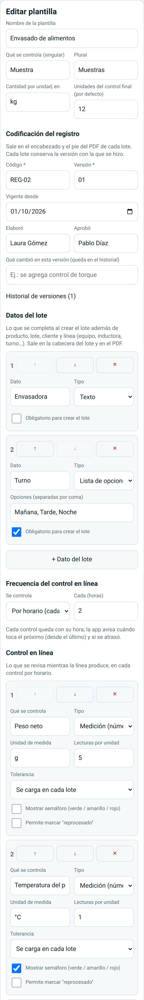

En el editor:

- **Qué se controla**: el nombre de la unidad (Pallet, Caja, Muestra…) en singular y plural, y
  si lleva **cantidad** (L, kg, unid.) para sumar lo aprobado y lo retenido.
- **Datos del lote**: lo que se completa al crear el lote además de producto, lote, cliente y
  línea (equipo, inductora, turno…). Cada dato es texto, **lista de opciones** (escritas
  separadas por coma), número o fecha, y puede ser obligatorio. Sale en la cabecera del lote y
  en el PDF.
- **Frecuencia del control en línea**: **por unidad** (un control por pallet, caja…) o **por
  horario**, cada tantas horas (se aceptan decimales: 1,5 = cada 1 h 30 min).
- **Ítems del control en línea y del control final**, cada uno de un tipo:
  - **OK / NOK**, y si permite marcarlo como *reprocesado*.
  - **Medición**: unidad, cuántas lecturas por unidad y la **tolerancia**: fija (mínimo y máximo
    en la plantilla), *se carga en cada lote* (para lo que depende del producto, como el peso) o
    sin tolerancia (solo se registra). Opcional: semáforo.
  - **Texto** o **fecha**.
- En el control final, si cada ítem es **obligatorio para dictaminar**.
- ↑ ↓ cambian el orden y ✕ quita el ítem.

Los lotes ya creados **no cambian** si editás o borrás una plantilla: cada lote guarda una copia
de la plantilla con la que se hizo.

### Productos

El catálogo es **optativo** y ahorra tipeo al crear cada lote. Cada producto tiene su nombre,
un código opcional, la **plantilla** con la que se controla, los **rangos por defecto** de las
mediciones que se cargan en cada lote, la **cantidad por unidad** (por ejemplo 1000 L por
pallet), cuántas unidades lleva el control final y los **datos del lote por defecto** (por
ejemplo, la inductora que usa).

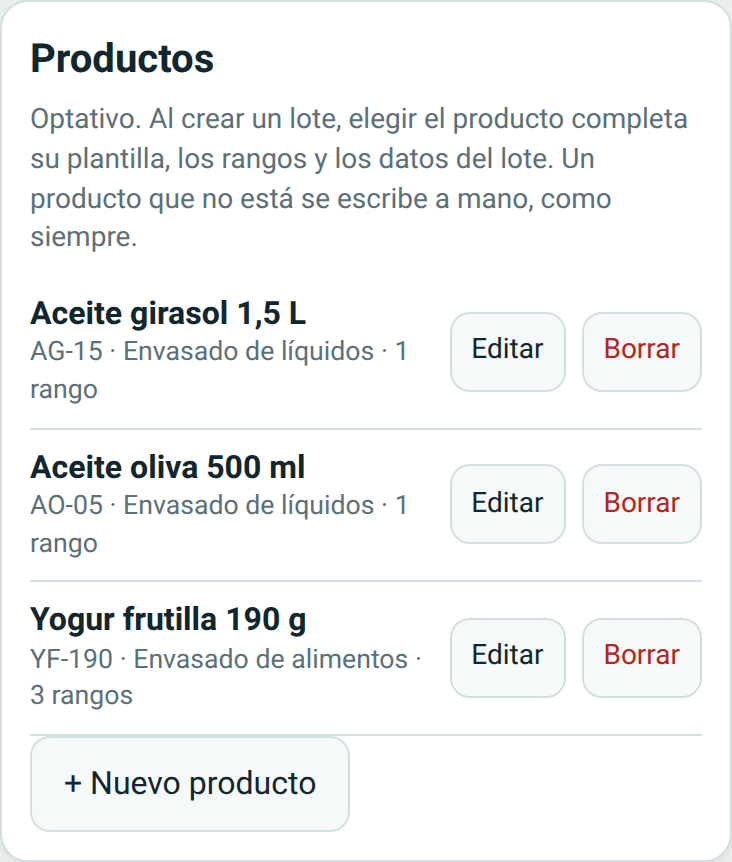

- Para no cargarlo dos veces: al crear un lote con un producto que no está, marcá **Guardar
  este producto en el catálogo** y queda con todo lo que cargaste.
- Corregir o borrar un producto no cambia los lotes ya creados: cada lote guarda sus valores.
- Lo administra **Administración**; el resto lo usa al crear lotes.

#### Codificación del registro

Cada plantilla es un **registro del sistema de gestión** y lleva su codificación, como pide la
norma (ISO 9001, 7.5): **código** (por ejemplo REG-01, obligatorio y sin repetir), **versión**,
**vigente desde**, quién **elaboró** y quién **aprobó**. Sale en el encabezado y el pie del PDF.

- Si cambiás **qué se controla** (agregás, sacás o modificás un ítem) y no subiste la versión, la
  app te ofrece guardar como versión nueva (03 → 04) con la fecha de hoy. Si fue solo una
  corrección menor, como un texto mal escrito, podés guardar sin cambiar la versión.
- En **Qué cambió en esta versión** anotá el motivo: queda en el **Historial de versiones** con
  la fecha y quién lo hizo.
- Cada lote conserva la codificación con la que se hizo: el PDF de un lote viejo sale con su
  versión aunque la plantilla ya vaya por otra.
- **Duplicar** una plantilla crea otro registro: arranca sin código, en versión 00.

| Rol | Puede |
|---|---|
| **Inspector de Calidad** | Crear y controlar lotes. Dictaminar con el control final completo. Cargar, cerrar y anular NC |
| **Coordinación** | Además: dictaminar con unidades pendientes, reabrir o corregir lotes dictaminados, borrar lotes |
| **Administración** | Además: configurar la empresa, las plantillas y el catálogo de productos, e invitar personas |

## 9. Sin señal

QualityOS está hecha para la planta: **todo se guarda primero en el equipo** y se sube solo
cuando hay conexión. Arriba a la derecha ves el estado:

| Indicador | Qué significa |
|---|---|
| ☁ **Al día** | Todo lo cargado ya está en el servidor |
| ⏳ **N por subir** | Hay cambios guardados en el equipo esperando subir |
| ✈ **Sin señal** | Seguí trabajando normal: se sube cuando vuelva la conexión |
| ⚠ **Conflicto** | Otro equipo cambió el mismo lote o la misma NC. Tocalo y elegí qué versión queda: nada se pierde |

## 10. Preguntas frecuentes

**Creé la cuenta pero dice que no pertenezco a ninguna empresa.**
Pedile al administrador que te invite con **el mismo email** con el que creaste la cuenta.
Después tocá **Buscar invitaciones**.

**No me llegó el mail de confirmación.**
Revisá spam o correo no deseado. Si no aparece, pedí ayuda al administrador.

**Me equivoqué en un dato del lote.**
Mientras está en control, **Editar datos** corrige la cabecera y cualquier campo se cambia
tocándolo. Si ya está dictaminado, pedile a Coordinación que lo reabra.

**¿Puedo usarla en más de un equipo?**
Sí. Con la misma cuenta, en el celular y en la tablet: lo que cargás en uno aparece en el otro
cuando ambos tienen señal.

**Cerré sesión con cambios sin subir.**
Quedan guardados en ese equipo y se suben la próxima vez que entre alguien de tu empresa en él.
